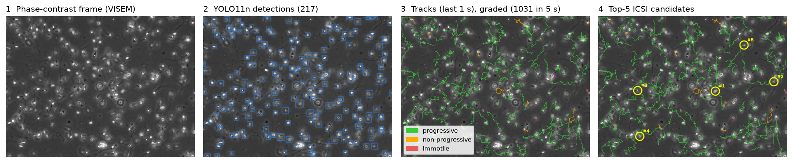
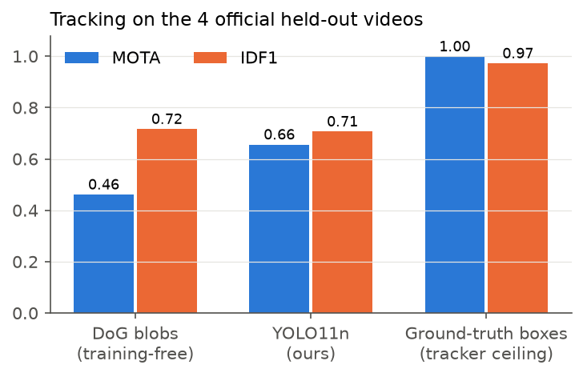
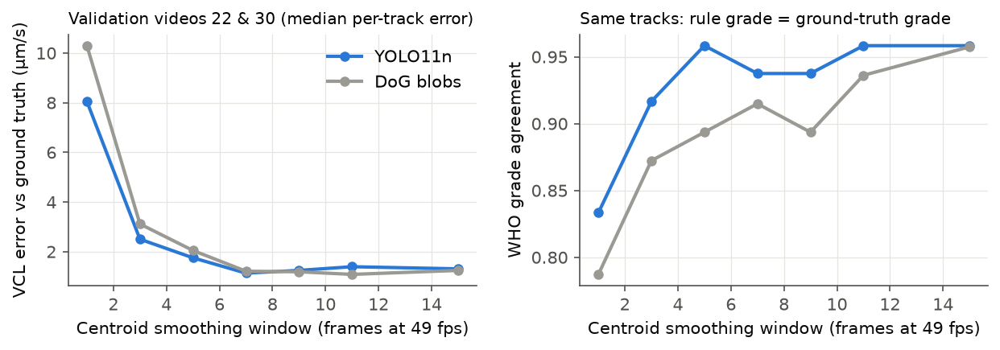
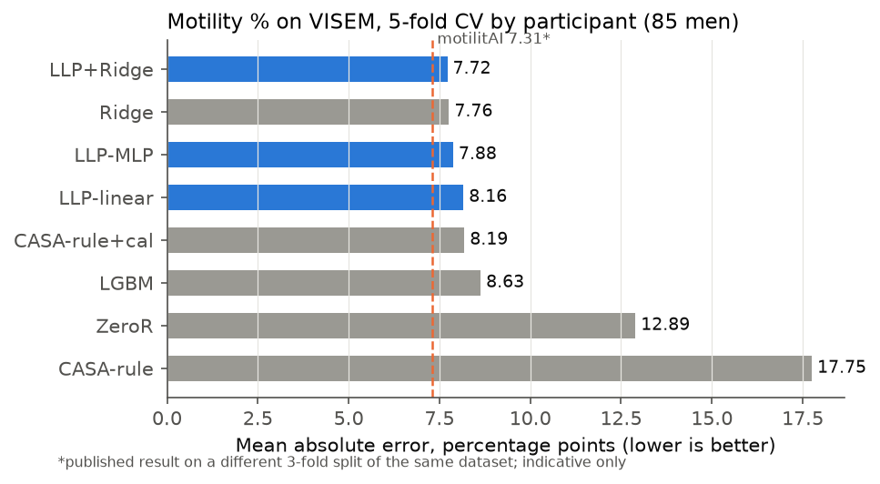
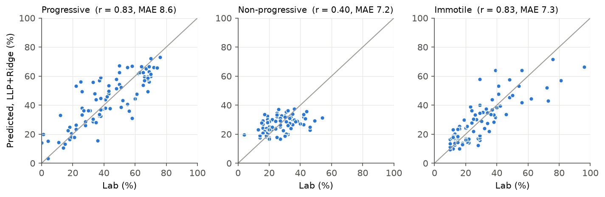
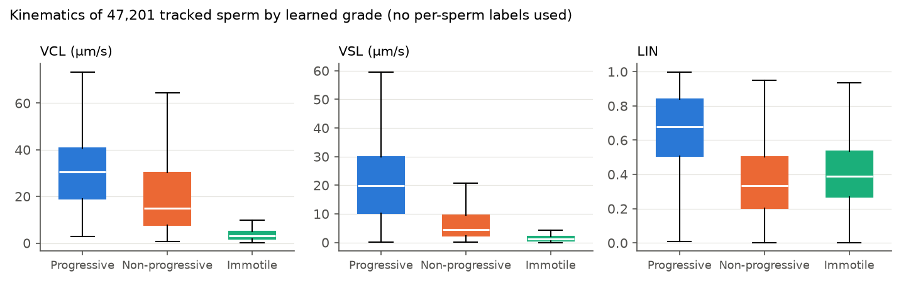
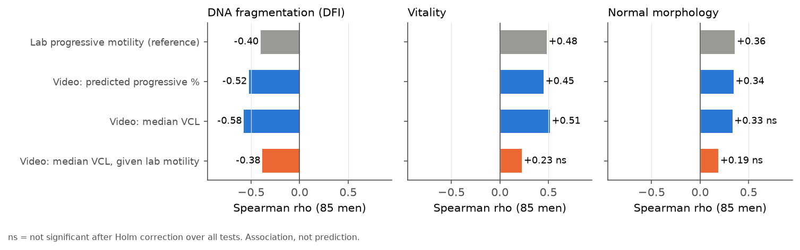

# SpermSelect-AI — Video-Based Sperm Selection for ICSI Ahead of Embryo Vitrification

 

  

> **From a 10-second microscopy video: detect and track every spermatozoon, measure WHO/CASA kinematics, grade each cell, and rank the best candidates for ICSI.**

**Where this sits in IVF.** In ICSI (intracytoplasmic sperm injection) an embryologist picks *one* sperm per egg, by eye. The resulting embryos are cultured and the good ones are **vitrified** (ultra-rapid freezing) for later transfer. Sperm selection is the first quality gate in that chain, and today it is subjective. SpermSelect-AI makes that gate measurable. It reports sample-level values that match the andrology lab and gives a ranked, explainable shortlist of individual sperm.

**Scope.** This project covers the sperm-selection step only. No public dataset links individual sperm to fertilisation, embryo or vitrification outcomes, so those outcomes are **not** predicted or claimed here.

## Pipeline

1. **Detect.** A YOLO11n detector fine-tuned on VISEM-Tracking finds sperm heads in every frame (CPU, 512 px input).
2. **Track.** A vectorised constant-velocity Kalman filter with Hungarian assignment links detections over time. The distance gate widens for fast cells.
3. **Measure.** WHO 2021 / CASA kinematics per sperm in 1-s windows: VCL, VSL, VAP, LIN, STR, WOB, ALH, BCF and MAD. Calibration is 0.495 µm/px, verified from flagellum length. Centroids are first smoothed with a 7-frame running mean, chosen on validation videos (see results).
4. **Grade.** Each sperm is classed **progressive / non-progressive / immotile** by a softmax grader trained with **learning from label proportions (LLP)**. No dataset has per-sperm motility labels, so the grader is trained so that each man's *duration-weighted mix* of predicted grades matches his lab percentages.
5. **Rank.** Quality score = P(progressive) × straightness × speed × track reliability. The top-k candidates are shown on the video.
6. **Report.** Sample estimates (progressive %, total motility %, concentration) are compared with WHO 2021 lower reference limits, and a PDF report is produced.

## Data

| Dataset | Content | Use |
|---|---|---|
| **VISEM-Tracking** (Thambawita et al., 2023, *Sci Data* 10:260, CC BY 4.0) | 20 videos × 30 s, 640×480 @ 49 fps; boxes and track IDs (sperm / cluster / pinhead) | detector training, tracking and kinematics benchmark |
| **VISEM** (Haugen et al., 2019, ACM MMSys, CC BY 4.0) | 85 men: videos + lab motility %, concentration, DNA fragmentation, morphology, vitality | motility / concentration benchmark, health-marker analysis |

**Splits (no leakage):**
- **Detection and tracking:** the official held-out VISEM-Tracking videos 52, 54, 60 and 82 are the test set. Videos 22 and 30 are used for validation. Every choice (checkpoint, confidence threshold, smoothing window) was made on validation only.
- **Motility:** participant-level 5-fold cross-validation using the official VISEM folds. All methods see identical tracks.

The data are not redistributed; `scripts/download_data.py` fetches them.

## Results

### 1. Detection: official held-out videos (588 frames)

| Detector | Precision | Recall | **F1** (centre ≤ 10 px) |
|---|---|---|---|
| DoG blobs (training-free baseline, tuned on train) | 0.684 | 0.851 | 0.759 |
| **YOLO11n (ours)** | **0.827** | 0.804 | **0.815** |

The validation F1 was 0.958. COCO mAP50 on these test videos is 0.23, but that low figure is an **annotation-convention artifact**, not missed sperm:
- The median centre error is 1.4–2.8 px on every video.
- Test videos 54 and 60 were annotated with ~29 px boxes, while the other videos (and our predictions) use ~17–19 px. Only 12 % and 30 % of correct detections in those two videos reach IoU ≥ 0.5, vs 88–99 % in the others.

The original paper also used these four videos for validation, not as a blind test. See `results/box_size_analysis.csv`.

### 2. Tracking: same held-out videos (motmetrics, 10 px)

| Detector feeding the tracker | MOTA | IDF1 | ID switches / video |
|---|---|---|---|
| DoG blobs | 0.461 | 0.716 | 24 |
| **YOLO11n (ours)** | **0.656** | 0.707 | 46 |
| Ground-truth boxes (tracker ceiling) | 0.999 | 0.972 | 1.5 |

With perfect boxes the tracker is near-perfect. The remaining error comes from detection in crowded and out-of-focus regions.

### 3. Kinematics: a correction that mattered

Measured against the ground-truth track positions, raw detected tracks overestimated curvilinear velocity (VCL) of slow sperm 3–4×. Frame-to-frame centroid jitter adds false path length, a classic CASA artefact. A centred running mean over the centroids was tuned on the **validation** videos (w = 7 frames ≈ 0.14 s). Per-track agreement with ground-truth tracks on the untouched **test** videos:

| YOLO tracks, test videos (98 matched tracks) | VCL error (median) | LIN error | WHO grade agreement |
|---|---|---|---|
| raw centroids | 4.80 µm/s | 0.50 | 77.6 % |
| **smoothed (w = 7)** | **0.88 µm/s** | **0.26** | **94.9 %** |

### 4. Sample-level motility vs the andrology lab (85 men, 5-fold CV)

Each man is scored on 10 s of video (one clip). Lab values are progressive, non-progressive and immotile %. MAE is averaged over the three, and the gain is MAE reduction vs ZeroR with a bootstrap 95 % CI.

| Method (YOLO11n tracks) | MAE ↓ | Gain vs ZeroR (95 % CI) | r, progressive % |
|---|---|---|---|
| ZeroR (training mean) | 12.89 | — | — |
| CASA rule (WHO-style thresholds, no training) | 17.75 | −4.86 | 0.79 |
| CASA rule + linear recalibration | 8.19 | 4.71 (3.31–6.06) | 0.84 |
| LightGBM on kinematic summaries | 8.63 | 4.26 (2.42–6.08) | 0.77 |
| Ridge on kinematic summaries | 7.76 | 5.13 (3.42–6.96) | 0.82 |
| LLP per-sperm grader, linear (used in the app) | 8.16 | 4.73 (2.97–6.48) | 0.82 |
| LLP per-sperm grader, MLP | 7.88 | 5.02 (3.30–6.67) | 0.84 |
| **LLP + Ridge** | **7.72** | **5.18 (3.48–6.96)** | 0.83 |

- **Error falls by 40 % vs ZeroR.** Fixed WHO-style thresholds rank men well (r = 0.79) but are badly miscalibrated for this optical set-up, which is why a learned grader is needed.
- **The LLP grader is interpretable.** It is as accurate as sample-level regression, but it also grades **every individual sperm**, which a regression model cannot do. That per-sperm grade is what makes a shortlist possible.
- **Both detectors give the same sample-level accuracy.** On the identical 85 clips the DoG baseline reaches LLP + Ridge 7.88. Sample-level motility is robust to the detector; YOLO's advantage is cleaner per-sperm tracks (detection F1, MOTA).

**Concentration.** Mean detected sperm per frame, log-calibrated on the training folds, estimates concentration with Spearman ρ = **0.78** vs the lab (MAE 30 vs 49 M/mL for the median guess). It flags samples below the WHO limit of 16 M/mL with **AUROC 0.91**.

### 5. Does the LLP grader learn per-sperm grades?

Per-sperm labels do not exist in VISEM, so this was tested in simulation: 85 simulated men, overlapping kinematic distributions, and lab percentages with ±5-point noise. LLP recovers per-sperm grades with **95.9 %** accuracy. A fully supervised grader with per-sperm labels reaches 97.5 %; the fixed WHO-style threshold rule reaches 50.2 % (chance 44.7 %). On real data (47,201 tracked sperm) the learned grades separate cleanly by kinematics. Median VCL is 30.6 / 15.0 / 3.1 µm/s and median LIN is 0.68 / 0.33 / 0.39 for progressive / non-progressive / immotile:

### 6. Beyond motility: video kinematics and sperm health (exploratory)

Across the 85 men, the median curvilinear velocity of tracked sperm correlates with the **DNA fragmentation index** at ρ = **−0.58**. That is stronger than the lab's own progressive-motility value (ρ = −0.40). The association **survives controlling for lab motility** (partial ρ = −0.38, Holm-adjusted p = 0.011). The video therefore carries DNA-integrity information beyond the standard motility percentage. For vitality and morphology, the video adds nothing significant beyond lab motility. All tests are Spearman correlations, Holm-corrected over the whole table ([`results/health_links_yolo.csv`](results/health_links_yolo.csv)).

This matters for the vitrification chain: DNA fragmentation of the injected sperm is linked to embryo quality. It suggests that sperm selection by kinematics also enriches for DNA-intact sperm, which is a testable hypothesis for a prospective ICSI study.

## Clinician app

A Streamlit app ([live here](https://spermselect-ai.streamlit.app/); code in the private repository) takes an uploaded phase-contrast video (MP4/AVI) or a built-in example. It returns:
- an **ICSI shortlist**: the top-k sperm with their kinematics, highlighted on the video;
- the **tracked video**, coloured green (progressive), orange (non-progressive), red (immotile) or yellow (shortlisted);
- a **per-sperm table** with CSV download;
- a **PDF report** with sample estimates against WHO 2021 reference limits (progressive ≥ 30 %, total motility ≥ 42 %, concentration ≥ 16 M/mL).

Calibration (µm/px) is adjustable for other microscopes. The smoothing window scales with frame rate.

## How this compares with published work

- **VISEM-Tracking paper.** YOLOv5n reached mAP50 0.749 (all classes) on videos 52/54/60/82, used there as validation. Our mAP is not comparable, because of the box-convention mismatch described above. Point-F1 is reported instead.
- **Medico 2019 / motilitAI.** Motility MAE was 8.83 (Medico best) and 7.31 (motilitAI). Those used a different 3-fold split, so the comparison is indicative only. Our ZeroR baseline on the official 5-fold split is 12.89.

## Source code

This public repository is a **showcase**: write-up, figures, research design ([`docs/METHODOLOGY_SELECTION.md`](docs/METHODOLOGY_SELECTION.md)) and all reported metrics ([`results/`](results/)). The full pipeline lives in a private repository: download, YOLO training, tracker, kinematics, LLP grader, evaluation scripts, trained weights, tests and the clinician app. **A live demo is at [spermselect-ai.streamlit.app](https://spermselect-ai.streamlit.app/). Source access is available on request** via GitHub ([Engr-HusainNaqvi](https://github.com/Engr-HusainNaqvi)).

## Limitations

- **Single-centre public data**, recorded with one microscope set-up and wet semen preparations, not ICSI dishes (PVP, washed sperm).
- **No per-sperm ground truth for motility class**, so per-sperm accuracy is shown only in simulation. Sample-level agreement is shown on real data.
- **No fertilisation, embryo or vitrification outcomes.** The ICSI ranking is a kinematics-based proposal that needs prospective validation.
- **Morphology is not assessed** (heads are ~17 px at this magnification).
- **Research and education only. Not a medical device.**

## Citation & license

**Copyright © 2026 Husain Naqvi. All Rights Reserved.** See [LICENSE](LICENSE). No reuse without written permission. Reviewers (admissions committees, prospective supervisors, employers) may view the work for evaluation.

Data:
- Thambawita V. et al. *VISEM-Tracking, a human spermatozoa tracking dataset.* Sci Data 10, 260 (2023). [doi:10.1038/s41597-023-02173-4](https://doi.org/10.1038/s41597-023-02173-4)
- Haugen T.B. et al. *VISEM: a multimodal video dataset of human spermatozoa.* ACM MMSys (2019). [doi:10.1145/3304109.3325814](https://doi.org/10.1145/3304109.3325814)
